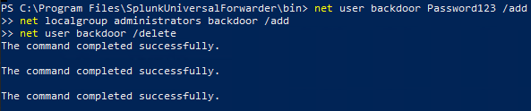
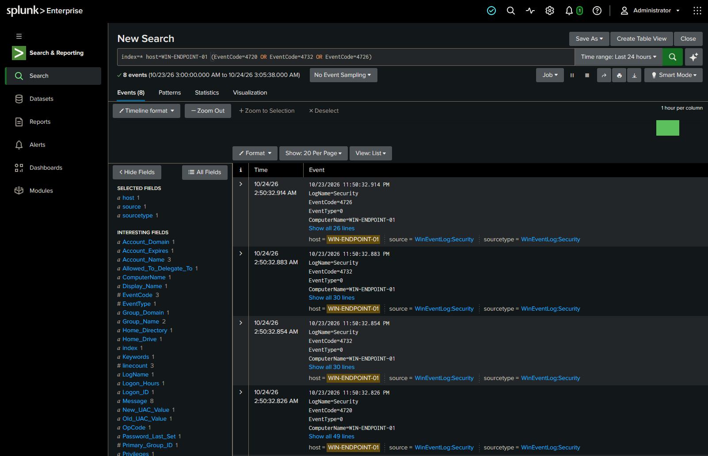

# Incident Report — New Admin Account Created

| Field | Detail |
|---|---|
| **Analyst** | Jassiel Alvarez |
| **Date** | 2026-10-24 |
| **Host** | WIN-ENDPOINT-01 (192.168.50.215) |
| **Account** | `backdoor` |
| **Severity** | High |
| **Verdict** | True Positive |
| **MITRE ATT&CK** | T1136.001 – Create Account |
| **URL** | https://attack.mitre.org/techniques/T1136/001/ |

---

## Summary
A new user account called `backdoor` was created on WIN-ENDPOINT-01, added to the Administrators group, and then deleted a short time later. Creating an admin account and quickly deleting it looks like someone trying to get access and then hide it. I marked this as a real issue (True Positive).

---

## Timeline

| Time | What Happened | Event ID |
|---|---|---|
| 2:50:32.854 | Account `backdoor` created | 4720 |
| 2:50:32.883 | `backdoor` added to Administrators | 4732 |
| 2:50:32.914 | Account `backdoor` deleted | 4726 |

---

## How I Found It

**Search I ran in Splunk:**
```
index=* host=WIN-ENDPOINT-01 (EventCode=4720 OR EventCode=4732 OR EventCode=4726)
```

**What I saw:**
- Account was created and added as a administrator then was deleted (what caused the alert)




---

## Why It Matters
An admin account can control the whole computer. Even though this one was deleted fast, if it were real it could have been used as a hidden way back in.

---

## Recommendations
- Make sure the account is really gone.
- Set up a Splunk alert for new admin accounts.
- Check who had access to create accounts at that time.

---

## Notes
This was a test I ran myself to practice. A good alert would be: "tell me when a new account is created AND added to admins within a few minutes."
