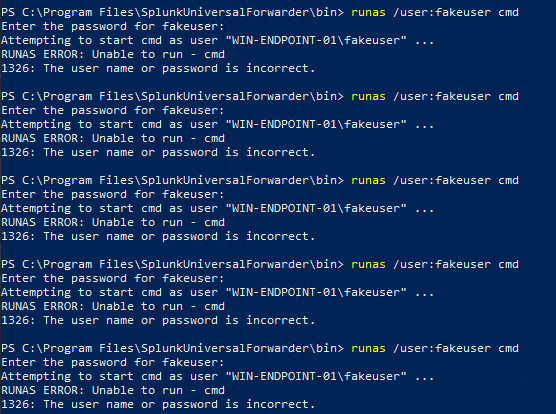
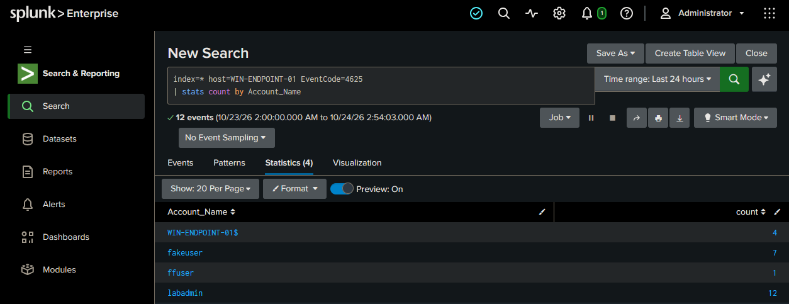
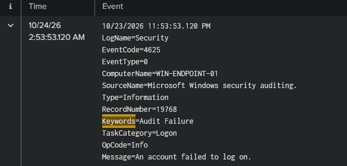
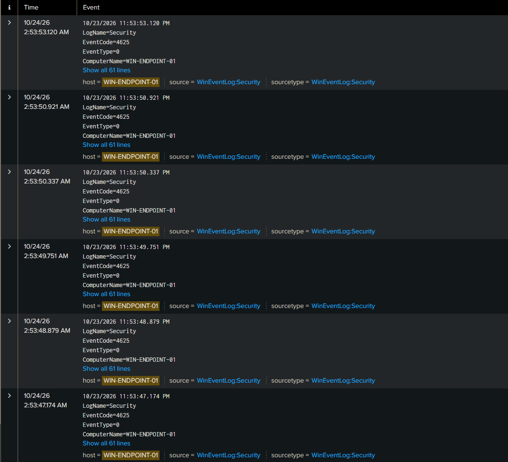

# Incident Report — Failed Login Attempts

| Field | Detail |
|---|---|
| **Analyst** | Jassiel Alvarez|
| **Date** | 2026-10-24 |
| **Host** | WIN-ENDPOINT-01 (192.168.50.215) |
| **Account targeted** | `fakeuser` |
| **Severity** | Medium |
| **Verdict** | True Positive |
| **MITRE ATT&CK** | T1110 – Brute Force |
| **URL** | https://attack.mitre.org/techniques/T1110/ |
---

## Summary
There were several failed login attempts on WIN-ENDPOINT-01 for the account `fakeuser` in a short period of time. A lot of failed logins for one account in a row is a sign of someone guessing a password (brute force). I marked this as a real issue (True Positive).

---

## Timeline

| Detail | Value |
|---|---|
| Account targeted | `fakeuser` |
| Number of failed logins | 7 |
| Time window | 2:53 AM |
| Any successful login after? | No |

---

## How I Found It

**Search I ran in Splunk:**
```
index=* host=WIN-ENDPOINT-01 EventCode=4625
| stats count by Account_Name
```

**What I saw:**
- Multiple failed logins (Event ID 4625) for the same account. (what caused the alert)
- No successful login (4624) followed, so the attempts did not get in.






---

## Why It Matters
Repeated failed logins can mean someone is trying to guess a password. If they ever succeed, they get into the account. Catching this early lets you lock the account or block the source.

---

## Recommendations
- Turn on account lockout after a set number of failed tries.
- Set up a Splunk alert for many failed logins in a short time.
- If this were real, check where the attempts came from.

---

## Notes
I created the failed logins myself for practice by entering a wrong password several times. Because no 4624 (successful login) followed, I know the attempts failed.
