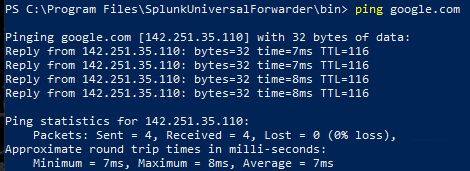
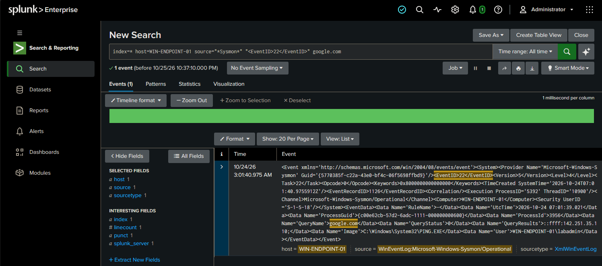

# Incident Report — DNS Lookups Review

| Field | Detail |
|---|---|
| **Analyst** | Jassiel Alvarez|
| **Date** | 2026-10-24 |
| **Host** | WIN-ENDPOINT-01 (192.168.50.215) |
| **Severity** | Low/Informational |
| **Verdict** | False Positive (normal activity) |
| **MITRE ATT&CK** | T1071 – Application Layer Protocol |
| **URL** | https://attack.mitre.org/techniques/T1071/ |
---

## Summary
I reviewed the DNS lookups (which websites programs tried to reach) on WIN-ENDPOINT-01. The domain looked normal (well-known site), so there was nothing suspicious. This is an example of checking DNS activity and deciding it is safe (False Positive).

---

## What I Looked At

| Domain Looked Up | Program | Normal? |
|---|---|---|
| google.com | ping / system | Yes |

---

## How I Found It

**Search I ran in Splunk:**
```
index=* host=WIN-ENDPOINT-01 source="*Sysmon*" "<EventID>22</EventID>" google.com
```
*Used `"<EventID>22</EventID>"` because Sysmon logs are XML and the Sysmon add-on wasn't extracting the EventCode field, so I matched the raw EventID tag instead.*

**What I saw:**
- DNS lookup events (Sysmon Event ID 22) showing which domains were requested and by which program.
- Ping from WIN-ENDPOINT-01 (192.168.50.215) to google.com (what caused the alert)





---

## Why It Matters
Malware often "phones home" to strange or random-looking domains. Reviewing DNS lookups is a quick way to spot that. In this case everything looked normal, but knowing how to check is the point.

---

## Recommendations
- Keep an eye out for random-looking domains (a sign of malware).
- Watch for system processes making DNS lookups they normally would not.

---

## Notes
I made the DNS lookups myself using `ping` (ping asks the Windows DNS client to look up the domain, which Sysmon records as Event 22). A real investigation would compare the domains against a threat intelligence list.
